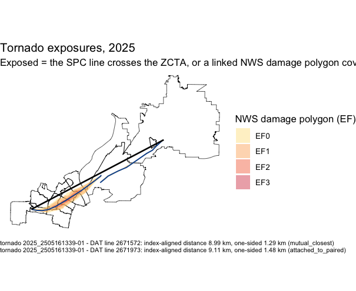

# tornadoexposure
`tornadoexposure` provides ZCTA-level tornado exposure data for the United States, 1996 to
2025, ready to use without assembling it from raw sources. A ZCTA (ZIP Code Tabulation Area) is the
Census Bureau's approximation of a ZIP code area. The tornado records come from the NOAA Storm Prediction Center
(SPC) and are combined with Census Bureau ZCTA boundaries, water polygons and block populations; the National Weather Service (NWS)
damage surveys are included unmodified, linked to the SPC tornadoes, and summarized by ZCTA, census tract and block group. A ZCTA is
exposed when the SPC line crosses it or a damage polygon of the linked NWS survey covers land in it; in each call you can instead choose
how close the SPC line must come to the ZCTA's centroid or boundary. The data are bundled, so only maps and boundary distances need an internet connection.

## Set-up
```r
remotes::install_github("UChicago-ExtremeWeather/tornadoexposure")
library(tornadoexposure)
```

## What the package provides
SPC provides a start point, an end point and a width for each tornado. The package draws only the straight line between the start and the end point; it draws no polygon from the width. The NWS damage polygons are the NWS's own survey shapes.

From the SPC (every tornado from 1996 on):

* `spc_records` (38,953 rows): the complete SPC record, every column and every row (whole-track rows, state segments and continuing county records), as SPC gives them.
* `tornado_tracks` (38,027 rows): one row per tornado. The geometry is the straight line from SPC's start to its end point, or a point at the start for a tornado with no usable end point (`track_type` is `"line"` or `"point"`; end coordinates missing, 0 or equal to the start: 10,384 tornadoes, 27.3%). SPC's raw coordinates, length and width stay as given (a width of 0 is not replaced); loss is given as SPC gives it and in dollars; `line_km` and `line_km_outside_zcta` give the length of the line and the part of it that lies in no ZCTA.
* `tornado_exposure` (57,407 rows, 37,382 tornadoes): one row per tornado and ZCTA that either source exposes. The SPC columns describe the line: whether it crosses the ZCTA, its length and share there, the loss allocated by that share, and the distance to the ZCTA boundary and to its population-weighted centroid. The DAT columns (below) describe the linked NWS polygons.

From the NWS Damage Assessment Toolkit (DAT), every feature the service holds, with every field, at full resolution and unmodified:

* `dat_lines` (13,021), `dat_polygons` (11,172) and `dat_points` (241,456).
* `tornado_dat_link` (11,573 rows): the DAT lines linked to SPC tornadoes, with every number that describes the link (no cutoff). `dat_polygon_line_link` (466,150 rows): the distance between each polygon and each line dated within a day, and the share of the line inside the polygon.
* The DAT columns of `tornado_exposure` (`NA` for a tornado with no linked line, 26,723 of the 37,382 tornadoes in it): the land-only share of the ZCTA covered by the union of the tornado's linked EF0 to EF5 polygons (each area counted once, with the part whose highest rated polygon is EF0, EF1, ... EF5 in `dat_area_share_ef0` to `dat_area_share_ef5`), the residents in that land (`dat_pop_affected`, and `dat_pop_ef0` to `dat_pop_ef5`), the damage points in the ZCTA dated within a day by `efscale` (`dat_points_*`), and the number of other SPC tornadoes crossing the ZCTA within a day. `dat_exposure_tract` (8,005 rows) and `dat_exposure_blockgroup` (12,308 rows) have the same DAT columns for census tracts and block groups, and no SPC columns because SPC's positions are not accurate enough to say which tract or block group a tornado crossed.

From the Census Bureau:

* `zcta_centroids` (98,932 rows): population-weighted centroids and areas, per ZCTA and Census boundary year (2000, 2010, 2020). Full TIGER/Line ZCTA boundaries, water polygons and block populations are used to build the tables and are not shipped.

The main variables of `tornado_exposure` (all are described in `?tornado_exposure`):

| Variable | Description |
|---|---|
| `tornado_id`, `date`, `year` | SPC year and SPC's record number for the tornado, joined (e.g. `2011_1105221634-01`); date |
| `magnitude` | EF rating 0 to 5 (the original Fujita scale before 2007), `NA` if unknown |
| `total_injury`, `total_fatality` | whole-tornado totals, repeated on each ZCTA row |
| `property_loss_tornado_total` / `property_loss_allocated` | SPC loss in dollars, whole tornado / the part assigned to the ZCTA by `line_share_of_tornado` (damage assumed spread evenly along the line); `NA` if SPC recorded 0: 19,567 of 38,027 tornadoes |
| `ZCTA` | five-character ZCTA code |
| `spc_exposed`, `dat_exposed` | the SPC line crosses the ZCTA (the start point lies in it, for a tornado with no usable end point) / a linked NWS polygon covers land in it (`NA` without a link). 724 rows are exposed only by the NWS polygons |
| `line_km_in_zcta`, `line_share_of_tornado` | kilometers of the line in the ZCTA (`NA` for a point) and the share of the line in the ZCTA (sums to 1 over a tornado's SPC rows) |
| `boundary_dist_km`, `centroid_dist_km` | distance in km from the SPC line (or start point) to the ZCTA boundary (0 exactly where the line crosses it) and to its population-weighted centroid |
| `zcta_pop`, `zcta_land_area_m2`, `zcta_polygon_area_m2`, `zcta_land_shape_area_m2` | residents, Census land area (`ALAND`), area of the full ZCTA polygon, area of the land-only shape (the polygon minus the Census water polygons) |
| `dat_linked`, `dat_line_ids` | the tornado has a linked DAT line / the linked line ids |
| `dat_area_share`, `dat_area_share_ef0` ... `dat_area_share_ef5` | land-only share covered by the linked polygons, in all and by highest rating (the parts sum to the total) |
| `dat_pop_affected`, `dat_pop_ef0` ... `dat_pop_ef5` | residents in the covered land, in all and by highest rating |
| `dat_points_ef0` ... `dat_points_ef5`, `dat_points_efu`, `dat_points_wind`, `dat_points_other` | DAT damage points in the ZCTA dated within one day of the tornado, by `efscale` as entered |
| `other_tornadoes_in_zcta_within_a_day` | other SPC tornadoes whose line crosses the ZCTA within a day, so you can see when points may belong to another tornado |

The DAT columns follow one rule: a damage polygon belongs to a tornado when a DAT line linked to it touches the polygon (`line_share_in_polygon` above 0 in `dat_polygon_line_link`: a zero test, not a cutoff). Only polygons rated EF0 to EF5 are used (6,072 polygons); the 343 touching polygons with another `efscale` stay in `dat_polygons`. Polygons with no date (254 of 11,172) are never linked and are not used.

## Functions
All functions take named arguments. The examples use the Joplin, Missouri
tornado (EF5, 22 May 2011) and the Moore, Oklahoma tornado (20 May 2013).

### `get_data()`
Returns a data frame with one row per tornado-ZCTA pair.

* `geo_list`: ZCTAs or prefixes of 1 to 5 digits, as strings (`"648"`).
* `year_range`: years, for example `2011` or `2010:2015`.
* `magnitude`: ratings to keep (default all, including unknown). `1:5` keeps EF1 and above and drops unknown ratings; `c(1:5, NA)` keeps unknown ones too; `5` keeps only EF5.
* `centroid_dist_km`, `boundary_dist_km`: a positive number of km, with no upper limit; the ZCTA's population-weighted centroid (the average location of its residents, from census block locations weighted by population), or its boundary (full TIGER/Line polygon; a download of 524 MB for 2010 boundaries, cached), must be within this distance of the SPC line (or of the start point). A row with a positive `boundary_dist_km` is a ZCTA that the line does not cross.

Use at most one of the last two (none returns the exposed ZCTAs of `tornado_exposure`: those the SPC line crosses and those only the NWS polygons cover). Every call prints how many tornadoes in the request have no usable end point (they are points, exposed only in the ZCTA that contains the start). Joplin, 2011, exposed ZCTAs:

```r
get_data(geo_list = "648", year_range = 2011, magnitude = 5)[
  c("ZCTA", "spc_exposed", "dat_exposed", "line_km_in_zcta", "line_share_of_tornado", "dat_area_share")]
#>    ZCTA spc_exposed dat_exposed line_km_in_zcta line_share_of_tornado
#> 1 64804        TRUE          NA          16.952                 0.500
#> 2 64840        TRUE          NA          11.639                 0.343
#> 3 64844        TRUE          NA           5.297                 0.156
#>   dat_area_share
#> 1             NA
#> 2             NA
#> 3             NA
```

The DAT columns are `NA` here because no NWS damage-survey line is linked to the Joplin tornado (`dat_linked` is `FALSE`); the Moore and St. Louis examples below have them filled.

```r
get_data(geo_list = "648", year_range = 2011, magnitude = 5,
         centroid_dist_km = 10)[c("ZCTA", "centroid_dist_km", "boundary_dist_km", "spc_exposed")]
#>    ZCTA centroid_dist_km boundary_dist_km spc_exposed
#> 1 64801            6.895               NA       FALSE
#> 2 64804            1.075                0        TRUE
#> 3 64840            1.019                0        TRUE
#> 4 64841            6.378               NA       FALSE
#> 5 64844            8.022                0        TRUE
```

```r
get_data(geo_list = "648", year_range = 2011, magnitude = 5,
         boundary_dist_km = 5)[c("ZCTA", "boundary_dist_km", "spc_exposed")]
#> Boundary distances use the full TIGER/Line ZCTA boundaries of 2010: a national file of about 524 MB, downloaded once and cached by tigris.
#>    ZCTA boundary_dist_km spc_exposed
#> 1 64801            2.494       FALSE
#> 2 64804            0.000        TRUE
#> 3 64840            0.000        TRUE
#> 4 64844            0.000        TRUE
#> 5 64850            1.177       FALSE
#> 6 64862            3.028       FALSE
```

The distances (10 km and 5 km) are examples, not recommendations.

The centroid result includes ZCTAs that neither source exposes (64801 and 64841 here), because the definition uses the centroid; their `spc_exposed` is `FALSE`. Several full ZCTAs and years in one call (Moore area, EF4 and EF5 tornadoes of 2010 to 2013):

```r
get_data(geo_list = c("73160", "73165", "73170"), year_range = 2010:2013, magnitude = 4:5)[
  c("ZCTA", "date", "magnitude", "line_share_of_tornado", "dat_area_share_ef4", "dat_area_share_ef5")]
#>    ZCTA       date magnitude line_share_of_tornado dat_area_share_ef4
#> 1 73160 2010-05-10         4                 0.137                 NA
#> 2 73165 2010-05-10         4                 0.307                 NA
#> 3 73170 2011-05-24         4                 0.028                 NA
#> 4 73160 2013-05-20         5                 0.310              0.009
#> 5 73165 2013-05-20         5                 0.182              0.000
#> 6 73170 2013-05-20         5                 0.261              0.013
#>   dat_area_share_ef5
#> 1                 NA
#> 2                 NA
#> 3                 NA
#> 4                  0
#> 5                  0
#> 6                  0
```

To save a result as a file, wrap the call in `write.csv()`:

```r
write.csv(get_data(geo_list = c("73160", "73165", "73170"), year_range = 2010:2013, magnitude = 4:5),
          "moore.csv", row.names = FALSE)
```

### `map_exposure()`
One map function. It takes the same arguments as `get_data()` and draws the layers named in `layers`: ZCTA, tract and block-group boundaries, SPC lines (points for tornadoes with no usable end point), the NWS damage lines, damage polygons (colored by EF rating) and damage points. No polygon is drawn from SPC's width. `feature` fills the ZCTAs with a summary of the exposures: `"tornado_id"`
maps the number of tornadoes, `"magnitude"` the average rating, `"total_fatality"` and `"total_injury"` the sums. The injury and fatality columns hold whole-tornado totals repeated on each ZCTA row, so these sums are not totals of people: do not add the columns across ZCTAs for a count of people.

```r
map_exposure(geo_list = "648", year_range = 2011, feature = "tornado_id")
#> Maps use the full TIGER/Line ZCTA boundaries of 2010: a national file of about 524 MB, downloaded once and cached by tigris.
```


Boundaries are the full TIGER/Line files and are downloaded from the Census Bureau the first time. The first `map_exposure()` call (2011 here) downloads a file of 524 MB and took about 17 seconds in testing; later calls use the cache. Years before 2010 use the 2000 boundaries (680 MB) and 2020 on the 2020 boundaries (528 MB). The function prints a note when a request is large or needs a large download.

### The NWS surveys and the St. Louis tornado of 16 May 2025
The National Weather Service surveyed the St. Louis tornado as two separate tornadoes from one storm circulation (an EF3 that lifted just north of Granite City and an EF1 that touched down just south of that point); SPC's file of 24 April 2026 predates that update of 15 May 2026 and holds one record. `tornado_dat_link` links that SPC record to both DAT lines, and `map_exposure()` draws the SPC line over them with the link distances in the caption:

```r
tornado_dat_link[tornado_dat_link$tornado_id == "2025_2505161339-01",
  c("dat_line_id", "index_aligned_dist_km", "one_sided_dist_km", "rule")]
#>       dat_line_id index_aligned_dist_km one_sided_dist_km               rule
#> 10957     2671572                 8.989             1.294     mutual_closest
#> 10958     2671973                 9.105             1.478 attached_to_paired
```

The tornado has 12 ZCTAs crossed by the SPC line and 13 ZCTAs with NWS polygon land; 4 are exposed only by the polygons (`spc_exposed` is `FALSE`):

```r
get_data(geo_list = stl_z, year_range = 2025, magnitude = 2)[
  c("ZCTA", "spc_exposed", "dat_exposed", "line_share_of_tornado", "dat_area_share", "dat_area_share_ef3", "dat_area_share_ef1")]
#>     ZCTA spc_exposed dat_exposed line_share_of_tornado dat_area_share
#> 1  62025        TRUE        TRUE                 0.225          0.008
#> 2  62026        TRUE        TRUE                 0.040          0.003
#> 3  62040        TRUE        TRUE                 0.265          0.062
#> 4  62048        TRUE        TRUE                 0.098          0.015
#> 5  63105        TRUE        TRUE                 0.044          0.449
#> 6  63107       FALSE        TRUE                    NA          0.291
#> 7  63108       FALSE        TRUE                    NA          0.392
#> 8  63110       FALSE        TRUE                    NA          0.091
#> 9  63112        TRUE        TRUE                 0.062          0.545
#> 10 63113       FALSE        TRUE                    NA          0.653
#> 11 63115        TRUE        TRUE                 0.072          0.515
#> 12 63120        TRUE       FALSE                 0.020          0.000
#> 13 63124        TRUE       FALSE                 0.001          0.000
#> 14 63130        TRUE        TRUE                 0.087          0.033
#> 15 63133        TRUE       FALSE                 0.014          0.000
#> 16 63147        TRUE        TRUE                 0.072          0.210
#>    dat_area_share_ef3 dat_area_share_ef1
#> 1               0.000              0.001
#> 2               0.000              0.000
#> 3               0.000              0.023
#> 4               0.000              0.013
#> 5               0.000              0.319
#> 6               0.000              0.172
#> 7               0.002              0.187
#> 8               0.000              0.049
#> 9               0.000              0.324
#> 10              0.069              0.329
#> 11              0.011              0.204
#> 12              0.000              0.000
#> 13              0.000              0.000
#> 14              0.000              0.008
#> 15              0.000              0.000
#> 16              0.000              0.133
```

```r
map_exposure(geo_list = stl_z, year_range = 2025, magnitude = 2,
             layers = c("zcta", "spc_tracks", "dat_polygons", "dat_lines"))
#> Maps use the full TIGER/Line ZCTA boundaries of 2020: a national file of about 528 MB, downloaded once and cached by tigris.
```



### Exposed ZCTAs of the SPC line compared with the NWS polygons
For the 3,042 tornadoes that have a linked DAT line and at least one linked EF0 to EF5 polygon (`data-raw/qa/66_spc_vs_dat.R`), the SPC line and the polygons expose the same ZCTA in 5,896 tornado-ZCTA pairs, the line alone in 245 and the polygons alone in 724: the two sets of ZCTAs agree for 85.9% (pairs in both over pairs in either). The median per-tornado agreement is 100.0%, and 2,643 of the tornadoes have identical sets. The polygons are the NWS's own survey shapes, and their accuracy has not been measured.

### Tornadoes with no usable end point
10,384 tornadoes (27.3%) have no usable end point. 84.2% of them are EF0 and the median reported length is 0.20 mile, but 1,448 are 1 mile or longer, 117 are 5 miles or longer and the longest is 80.0 miles; 7,849 are from 1996 to 2006 and 2,535 from 2007 on; they account for 1,221 injuries and 38 deaths. Each is a point at its start; the real path may extend up to the reported length in an unknown direction. Such a tornado is exposed only in the ZCTA that contains the start point, and 412 have no SPC row because the start lies in no ZCTA. The tables are in `data-raw/known_issues.md`.

## What is and is not done to the source data
The data start in 1996, as the original package did; SPC's file begins in 1950 and no reason for the 1996 start is documented. The package never rounds, snaps, simplifies, generalizes, caps or imputes a source value or geometry: SPC's coordinates, length, width, rating, injuries, deaths and loss are as SPC gives them (the loss in dollars is an exact conversion, and the raw value is kept), the DAT features are as the service gives them (dates are kept as milliseconds with a UTC copy), and the Census inputs are used as published. The operations that are applied, each with the number of records or features it touches, are listed in `data-raw/known_issues.md` (section "What is and is not done to the source data"): projection, merging polygons, repairing invalid geometry, and subtracting the Census water polygons from Census unit shapes (land-only shapes: 29,352 of the 33,791 ZCTAs of the 2020 boundary year have water inside; the land-only area is within 1% of the Census land area for 99.3% of them).

The SPC line is a straight line between two rounded points. It is not the path of the damage at scales finer than a kilometer: the largest distance between the surveyed centerline and the SPC line has a median of 0.23 km and a 90th percentile of 1.78 km for the 11,369 line tornadoes linked to a survey line (`data-raw/known_issues.md` gives the values by length).

## Limitations
Numbers for each point, and how they were computed: `data-raw/known_issues.md`.

* The SPC line is straight from SPC's start point to its end point. Real paths curve, and the SPC width is not used for any shape. `line_share_of_tornado` and `property_loss_allocated` assume that damage is spread evenly along the line.
* Coordinates before 2007 are given by SPC to 0.01 degrees (about 1.1 km of latitude); from 2007 they have
  0.0001 degrees (about 11 m). In a simulation that moves the coordinates by the rounding amount (1,000 tornadoes per period), the list of ZCTAs
  changes for 7.0% of tornadoes before 2007 and 0.2% from 2007 (per replicate).
* A tornado with no usable end point (start equal to end, or an end that is zero or missing) is a point at its start, because its direction is unknown: 10,384 tornadoes (27.3% of all). A width of 0 or missing (138 line tornadoes) is never replaced.
* The DAT columns exist only for tornadoes with a linked DAT line. Surveys do not cover every tornado (coverage grows from a few tornadoes in 2007 to most in 2025). The DAT polygons are the NWS's own survey shapes and their accuracy has not been measured. Points are not linked to tornadoes by any rule: a damage point dated within a day of a tornado can belong to another tornado of the same day (`other_tornadoes_in_zcta_within_a_day`).
* Residents are allocated from census blocks by the share of each block's land covered (uniform density on the land of a block). The 2020 block counts have disclosure-avoidance noise added by the Census Bureau. Population uses the 2000 census for tornadoes before 2010, the 2010 census for 2010 to 2019 and the 2020 census from 2020.
* Exposure uses the Census boundary year (2000, 2010 or 2020) that matches the tornado's year: 2000 before 2010, 2010 for 2010 to 2019, 2020 from 2020. The same ZCTA code can cover a different area in different boundary years: 8.2% of the codes in both the 2010 and 2020 files overlap by less than half (intersection over union).
* 645 tornadoes (1.7%) have no SPC row (their line crosses no ZCTA of the boundary year, or their start point lies in none): 115 are over water, 397 are over land with no ZCTA nearby, 133 are on land that is mostly covered by no ZCTA. 645 of them have no row at all (no linked NWS polygon covers land in a ZCTA either).
* Unknown ratings (`NA`) appear only from 2007: 1,546 tornadoes, 0 before 2007. EF0 counts across years are comparable only if unknown ratings are included: in 2023, 442 tornadoes are EF0 and 268 are unknown.
* SPC loss is `NA` where SPC recorded 0 (which NOAA says does not mean $0): 19,567 of
  38,027 tornadoes. SPC reports loss in millions of dollars before 2007 and in dollars from 2007; the package converts everything to dollars. The values are nominal (not adjusted for inflation).
* `tornado_id` is unique within a package version but is not stable across SPC releases from 2007 on.
* The DAT data are preliminary; the dataset is described by its stewards as intended for public access and use ([NOAA Damage Assessment Toolkit page](https://disasters-geoplatform.hub.arcgis.com/pages/noaa-damage-assessment-toolkit-dat)). No license text was found, and this package does not claim that the data are in the public domain. `tornado_dat_link` has no cutoff: 474 of its 11,573 links have a one-sided distance above 5 km (an example, not a recommendation), so filter on the distance columns for your purpose.

## Citation
Data sources:

* NOAA Storm Prediction Center, [Severe Weather Database](https://www.spc.noaa.gov/wcm/) (accessed 2026-10-12).
* U.S. Census Bureau, TIGER/Line ZCTA boundary files for [2000](https://www2.census.gov/geo/tiger/TIGER2010/ZCTA5/2000/), [2010](https://www2.census.gov/geo/tiger/TIGER2010/ZCTA5/2010/) and [2020](https://www2.census.gov/geo/tiger/TIGER2020/ZCTA520/) (accessed 2026-10-12).
* U.S. Census Bureau, TIGER/Line tabulation block files ([2000](https://www2.census.gov/geo/tiger/TIGER2010/TABBLOCK/2000/), [2010](https://www2.census.gov/geo/tiger/TIGER2010/TABBLOCK/2010/), [2020](https://www2.census.gov/geo/tiger/TIGER2020/TABBLOCK20/)); the 2020 files also hold the 2020 block population (accessed 2026-10-12).
* U.S. Census Bureau, TIGER/Line water polygons (AREAWATER by county, [2010](https://www2.census.gov/geo/tiger/TIGER2010/AREAWATER/) for the 2000 and 2010 boundary years and [2020](https://www2.census.gov/geo/tiger/TIGER2020/AREAWATER/)) (accessed 2026-11-12).
* U.S. Census Bureau, decennial population counts for 2000 and 2010 ([PL 94-171 redistricting files, 2000](https://www2.census.gov/census_2000/datasets/redistricting_file--pl_94-171/) and [2010](https://www2.census.gov/census_2010/01-Redistricting_File--PL_94-171/)) (accessed 2026-10-12).
* NOAA National Weather Service [Damage Assessment Toolkit](https://apps.dat.noaa.gov/StormDamage/DamageViewer/) (queried 2026-11-11).

To cite the package, use the DOI of the archived release:
**To cite the package, use https://doi.org/10.5281/zenodo.23544841**.
See `citation("tornadoexposure")`.

## Acknowledgements
This work was supported by the Institute for Climate and Sustainable Growth (ISCG) and the Center
for Climate, Health and Society (CHAS).
