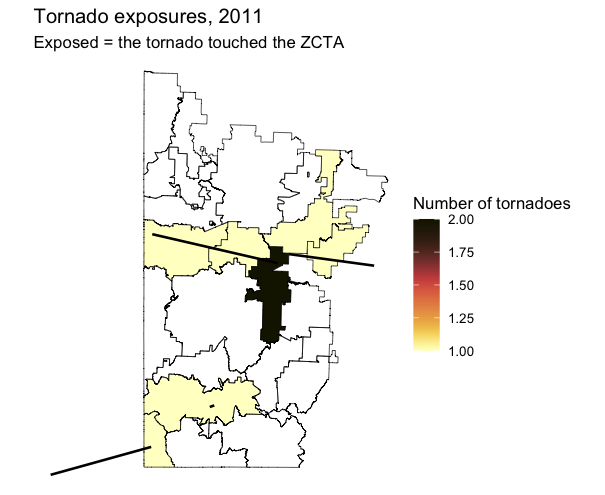

# tornadoexposure

`tornadoexposure` tells you which ZIP code areas (ZCTAs) each US tornado exposed, 1996 to 2025. It
combines two sources of tornado data, kept separate and linked: the Storm Prediction Center's catalog
of every tornado, and the National Weather Service's damage surveys. A ZCTA (ZIP Code Tabulation Area)
is the Census Bureau's approximation of a ZIP code area. The data are bundled, so only maps and
boundary distances need an internet connection.

```r
remotes::install_github("UChicago-ExtremeWeather/tornadoexposure")
library(tornadoexposure)
```

## The two sources

**SPC (NOAA Storm Prediction Center).** The national catalog of tornadoes. Each tornado has one record:
a start point, an end point, a length, a width, an EF rating, injuries, deaths and property loss. It
covers every tornado (38,027 from 1996 to 2025), but the path is only a straight line between two
points. Before 2007 the coordinates are rounded to about 1 km, and 10,384 tornadoes (27.3%) have no
usable end point, so they are a single point at the start.

**DAT (NWS Damage Assessment Toolkit).** The National Weather Service's damage surveys: damage points,
survey lines and damage polygons, which are the NWS's own survey shapes. It covers only surveyed
tornadoes (a few in 2007, most in 2025), and the data are preliminary. The package holds all of it,
unmodified: 241,456 points, 13,021 lines and 11,172 polygons.

**The link.** Each DAT line is linked to an SPC tornado by closeness, with no cutoff. The distances and
the rule used are in `tornado_dat_link`. A tornado can have more than one line: for the St. Louis
tornado of 16 May 2025, NWS surveyed two tornadoes from one storm circulation, while SPC has one
record. 10,659 of the 37,382 tornadoes in `tornado_exposure` have at least one linked line.

## Datasets

| Dataset | From | Rows | What it is |
|---|---|---|---|
| `spc_records` | SPC | 38,953 | the complete SPC record, as SPC gives it |
| `tornado_tracks` | SPC | 38,027 | one row per tornado, with the line (or the start point) |
| `dat_points`, `dat_lines`, `dat_polygons` | DAT | 241,456; 13,021; 11,172 | the survey features, unmodified |
| `tornado_dat_link` | link | 11,573 | which DAT line goes with which tornado, and how close they are |
| `dat_polygon_line_link` | link | 466,150 | which polygon touches which line |
| `tornado_exposure` | SPC and DAT | 57,407 | one row per tornado and exposed ZCTA |
| `dat_exposure_tract`, `dat_exposure_blockgroup` | DAT | 8,005; 12,308 | the DAT columns of `tornado_exposure` for tracts and block groups |
| `zcta_centroids` | Census | 98,932 | population-weighted centroids and areas of each ZCTA |

## What "exposed" means

* **SPC:** the straight SPC line crosses the ZCTA (`spc_exposed`). For a tornado with no usable end point, it is the ZCTA that contains the start point.
* **DAT:** a damage polygon of a linked survey covers land in the ZCTA (`dat_exposed`, `NA` without a link).

`tornado_exposure` has a row for every ZCTA that either source exposes.

## Columns of `tornado_exposure`

Every column is described in `?tornado_exposure`.

**The tornado (from SPC)**

| Column | Description |
|---|---|
| `tornado_id`, `date` | SPC year and record number joined (e.g. `2011_1105221634-01`); date |
| `magnitude` | EF rating 0 to 5 (original Fujita scale before 2007), `NA` if unknown |
| `total_injury`, `total_fatality` | whole-tornado totals, repeated on each ZCTA row; do not add them across rows |
| `property_loss_tornado_total`, `property_loss_allocated` | SPC loss in nominal dollars, whole tornado and the part assigned to the ZCTA by `line_share_of_tornado`; `NA` where SPC recorded 0 |

**The SPC line in the ZCTA**

| Column | Description |
|---|---|
| `ZCTA`, `spc_exposed` | the ZCTA, and whether the SPC line crosses it |
| `line_km_in_zcta`, `line_share_of_tornado` | kilometers of the line in the ZCTA, and its share of the whole line (sums to 1 over a tornado) |
| `boundary_dist_km`, `centroid_dist_km` | distance from the line to the ZCTA boundary (0 where it crosses) and to the population-weighted centroid |
| `zcta_pop`, `zcta_land_area_m2` | residents and land area of the ZCTA |

**The linked DAT survey (`NA` without a link)**

| Column | Description |
|---|---|
| `dat_exposed`, `dat_linked`, `dat_line_ids` | whether a linked polygon covers land in the ZCTA; whether the tornado has a linked line; the line ids |
| `dat_link_dist_km` | the largest distance (km) between the SPC line and a linked DAT line |
| `dat_area_share` | share of the ZCTA's land covered by the linked polygons (each area counted once) |
| `dat_pop_affected` | residents living on that covered land |
| `..._ef0` to `..._ef5` | the same shares and residents split by the highest rating covering each spot (they sum to the total) |
| `dat_points_ef0` ... `dat_points_other` | DAT damage points in the ZCTA dated within a day of the tornado, by `efscale` as entered |
| `other_tornadoes_in_zcta_within_a_day` | other SPC tornadoes crossing the ZCTA that day, since a damage point may belong to one of them |

## Using it

`get_data()` returns `tornado_exposure` rows for the ZCTAs and years you ask for. Use named arguments.

* `geo_list`: ZCTAs or prefixes of 1 to 5 digits, as strings (`"648"`).
* `year_range`: years, for example `2011` or `2010:2015`.
* `magnitude`: ratings to keep (default all, including unknown). `1:5` drops unknown ratings; `c(1:5, NA)` keeps them.
* `centroid_dist_km` or `boundary_dist_km`: use one, with a positive distance in km and no upper limit, to also get ZCTAs the line does not cross but comes within that distance of (the centroid is the average location of the ZCTA's residents).

**SPC only: the Joplin tornado (EF5, 22 May 2011).** No NWS survey is linked to it.

```r
get_data(geo_list = "648", year_range = 2011, magnitude = 5)[
  c("ZCTA", "spc_exposed", "line_km_in_zcta", "line_share_of_tornado")]
#>    ZCTA spc_exposed line_km_in_zcta line_share_of_tornado
#> 1 64804        TRUE          16.952                 0.500
#> 2 64840        TRUE          11.639                 0.343
#> 3 64844        TRUE           5.297                 0.156
```

**SPC and DAT: the St. Louis tornado (16 May 2025).** The link table shows the two NWS lines that go with
the one SPC record:

```r
tornado_dat_link[tornado_dat_link$tornado_id == "2025_2505161339-01",
  c("dat_line_id", "index_aligned_dist_km", "one_sided_dist_km", "rule")]
#>       dat_line_id index_aligned_dist_km one_sided_dist_km               rule
#> 10957     2671572                 8.989             1.294     mutual_closest
#> 10958     2671973                 9.105             1.478 attached_to_paired
```

The SPC line crosses 12 ZCTAs and the NWS polygons cover land in 13; 9 are in both and 4 only in the
polygons. For example (first five of 16 rows):

```r
head(get_data(geo_list = stl_z, year_range = 2025, magnitude = 2)[
  c("ZCTA", "spc_exposed", "dat_exposed", "line_share_of_tornado", "dat_area_share")], 5)
#>    ZCTA spc_exposed dat_exposed line_share_of_tornado dat_area_share
#> 1 62025        TRUE        TRUE                 0.225          0.008
#> 2 62026        TRUE        TRUE                 0.040          0.003
#> 3 62040        TRUE        TRUE                 0.265          0.062
#> 4 62048        TRUE        TRUE                 0.098          0.015
#> 5 63105        TRUE        TRUE                 0.044          0.449
```

**Maps.** `map_exposure()` takes the same arguments and draws ZCTA, tract and block-group boundaries and
the SPC lines, plus the DAT lines, polygons (colored by rating) and points when you list them in `layers`.
`feature` fills the ZCTAs with the number of tornadoes (`"tornado_id"`), the average rating
(`"magnitude"`), or the sum of `"total_fatality"` or `"total_injury"` (whole-tornado totals repeated on
each ZCTA row, so not counts of people).

```r
map_exposure(geo_list = "648", year_range = 2011, feature = "tornado_id")
```



The first map downloads the Census boundaries for the year (524 MB for 2010, 680 MB for 2000, 528 MB
for 2020) and caches them.

## Limitations

Numbers, and how each was computed: `data-raw/known_issues.md`.

* **SPC paths are straight lines.** Coordinates are rounded to about 1 km before 2007 (about 11 m from 2007). In a simulation that moves them by the rounding amount, the ZCTA list changes for 7.0% of tornadoes before 2007 and 0.2% from 2007.
* **27.3% of tornadoes have no usable end point.** They are a point at the start, and the real path may extend up to the reported length in an unknown direction.
* **DAT covers only surveyed tornadoes,** is preliminary, and the accuracy of the NWS polygons has not been measured. Damage points are not tied to a tornado; check `other_tornadoes_in_zcta_within_a_day`.
* **Links have no cutoff.** Filter on `dat_link_dist_km` and `boundary_dist_km` for your purpose. 724 rows (289 tornadoes) are exposed only by DAT polygons, and for 43 of those tornadoes some of these ZCTAs are more than 5 km from the SPC line, because some polygons are very large (the largest covers 220 ZCTAs). 5 km is an example, not a recommendation.
* **SPC and the NWS can disagree** on how many tornadoes an event was (St. Louis). SPC's 2025 file predates the NWS update of 15 May 2026.
* **SPC loss is `NA` where SPC recorded 0** (19,567 tornadoes), which NOAA says does not mean $0.
* **Unknown ratings exist only from 2016 on, apart from 21 in 2007.** Include them when comparing EF0 counts across years.
* **ZCTA codes change area between Census years.** Exposure uses the boundaries (2000, 2010 or 2020) that match the tornado's year.
* **645 tornadoes (1.7%) cross no ZCTA** and have no rows.
* **`tornado_id`** is not stable across SPC releases from 2007 on.

## Citation

Data sources:

* NOAA Storm Prediction Center, [Severe Weather Database](https://www.spc.noaa.gov/wcm/) (accessed 2026-10-12).
* NOAA National Weather Service, [Damage Assessment Toolkit](https://apps.dat.noaa.gov/StormDamage/DamageViewer/) (queried 2026-11-11). The stewards describe it as intended for public access and use ([page](https://disasters-geoplatform.hub.arcgis.com/pages/noaa-damage-assessment-toolkit-dat)); no license text was found, and this package does not claim the data are in the public domain.
* U.S. Census Bureau, TIGER/Line ZCTA boundaries ([2000](https://www2.census.gov/geo/tiger/TIGER2010/ZCTA5/2000/), [2010](https://www2.census.gov/geo/tiger/TIGER2010/ZCTA5/2010/), [2020](https://www2.census.gov/geo/tiger/TIGER2020/ZCTA520/)), tabulation blocks ([2000](https://www2.census.gov/geo/tiger/TIGER2010/TABBLOCK/2000/), [2010](https://www2.census.gov/geo/tiger/TIGER2010/TABBLOCK/2010/), [2020](https://www2.census.gov/geo/tiger/TIGER2020/TABBLOCK20/)) and water polygons ([2010](https://www2.census.gov/geo/tiger/TIGER2010/AREAWATER/), [2020](https://www2.census.gov/geo/tiger/TIGER2020/AREAWATER/)) (accessed 2026-10-12, water 2026-11-12), and the population counts of 2000 and 2010 ([2000](https://www2.census.gov/census_2000/datasets/redistricting_file--pl_94-171/), [2010](https://www2.census.gov/census_2010/01-Redistricting_File--PL_94-171/)).

To cite the package, use https://doi.org/10.5281/zenodo.23544841. See `citation("tornadoexposure")`.

## Acknowledgements

This work was supported by the Institute for Climate and Sustainable Growth (ISCG) and the Center for
Climate, Health and Society (CHAS).
