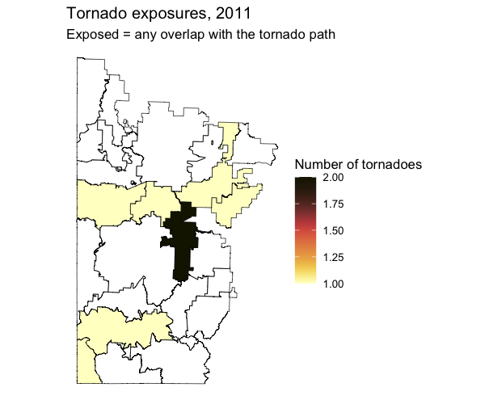
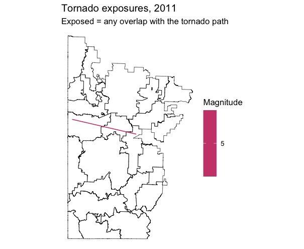
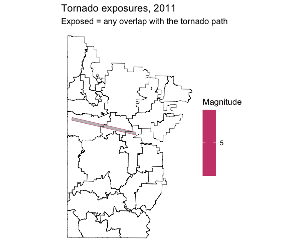

# tornadoexposure
`tornadoexposure` provides ZCTA-level tornado exposure data for the United States, 1996 to
2025, ready to use without assembling it from raw sources. A ZCTA (ZIP Code Tabulation Area) is the
Census Bureau's approximation of a ZIP code area. The tornado tracks come from the NOAA Storm Prediction Center
(SPC) and are combined with Census Bureau ZCTA boundaries and block populations. In each call you choose how a
ZCTA counts as exposed: the path overlaps it, covers a given share of its land area or residents, or its
centroid is within a given distance. The data are bundled, so only maps need an internet connection.

## Set-up
```r
remotes::install_github("UChicago-ExtremeWeather/tornadoexposure")
library(tornadoexposure)
```

## Data
| Dataset | Contents | Rows |
|---|---|---|
| `tornado_exposure` | one row per tornado and ZCTA the path overlaps | 58,162 |
| `tornado_tracks` | one row per tornado, with track geometry | 38,027 |
| `zcta_centroids` | population-weighted ZCTA centroids, per Census boundary year | 98,932 |
| `survey_exposure` | the same as `tornado_exposure`, from the surveyed damage area; only tornadoes with a usable survey swath | 6,007 |
| `survey_tracks` | surveyed damage swath of each tornado in `survey_exposure` | 2,941 |
| `survey_matches` | one row per SPC tornado since 2007: its closest survey line and whether the swath is usable | 24,162 |

The main variables of `tornado_exposure` (all are described in `?tornado_exposure`):

| Variable | Description |
|---|---|
| `tornado_id`, `date`, `year` | SPC year and SPC's record number for the tornado, joined (e.g. `2011_1105221634-01`); date |
| `magnitude` | EF rating 0 to 5 (the original Fujita scale before 2007), `NA` if unknown |
| `total_injury`, `total_fatality` | whole-tornado totals, repeated on each ZCTA row |
| `property_loss_tornado_total` / `property_loss_allocated` | SPC loss in dollars, whole tornado / the part assigned to the ZCTA by `area_share_of_tornado`; `NA` if SPC recorded 0: 19,567 of 38,027 tornadoes (51.5%) |
| `ZCTA` | five-character ZCTA code |
| `area_prop_affected` | share of the ZCTA's land area inside the path |
| `area_share_of_tornado` | share of the tornado's path area that lies in this ZCTA |
| `pop_affected`, `zcta_pop`, `pop_prop_affected` | residents in the path (fractional, because blocks are split by area); in the ZCTA; ratio |

## Functions
All functions take named arguments; every row returned is an exposed ZCTA. The examples use the Joplin, Missouri
tornado (EF5, 22 May 2011) and the Moore, Oklahoma tornado (20 May 2013).

### `get_data()`
Returns a data frame with one row per exposed tornado-ZCTA pair.

* `geo_list`: ZCTAs or prefixes of 1 to 5 digits, as strings (`"648"`).
* `year_range`: years, for example `2011` or `2010:2015`.
* `magnitude`: ratings to keep (default all, including unknown). `1:5` keeps EF1 and above and drops unknown ratings; `c(1:5, NA)` keeps unknown ones too; `5` keeps only EF5.
* `area_thresh`, `pop_thresh`: the share (a proportion from 0 to 1; 0 is not allowed) of the ZCTA's land area or residents the path must cover.
* `centroid_dist_km`: a positive number of km; the ZCTA's population-weighted centroid (the average location of its residents, from census block locations weighted by population) must be within this distance of the path. These results also have `dist_km`, `centroid_type` and `centroid_in_zcta`; a ZCTA with no residents uses its geometric center, with a warning.

Use at most one of the last three (none means overlap). The path is the straight line between SPC's start and end points, widened to SPC's width, or a disc for a tornado with no usable end point (the exposure columns use this path polygon). Joplin, 2011, under the four definitions (the values 0.05, 0.05 and 10 km are examples, not recommendations):

```r
get_data(geo_list = "648", year_range = 2011, magnitude = 5)[
  c("ZCTA", "area_prop_affected")]
#>    ZCTA area_prop_affected
#> 1 64804              0.101
#> 2 64840              0.144
#> 3 64844              0.039
```

```r
get_data(geo_list = "648", year_range = 2011, magnitude = 5,
         area_thresh = 0.05)[c("ZCTA", "area_prop_affected")]
#>    ZCTA area_prop_affected
#> 1 64804              0.101
#> 2 64840              0.144
```

```r
get_data(geo_list = "648", year_range = 2011, magnitude = 5,
         pop_thresh = 0.05)[c("ZCTA", "pop_prop_affected")]
#>    ZCTA pop_prop_affected
#> 1 64804             0.094
#> 2 64840             0.270
```

```r
get_data(geo_list = "648", year_range = 2011, magnitude = 5,
         centroid_dist_km = 10)[c("ZCTA", "dist_km")]
#>    ZCTA   dist_km
#> 1 64801     6.164
#> 2 64804     0.343
#> 3 64840     0.288
#> 4 64841     5.647
#> 5 64844     7.290
```

The last result includes ZCTAs the path did not overlap (64801 and 64841 here), because the
definition uses the centroid. Several full ZCTAs and years in one call (Moore area, EF4 and EF5 tornadoes of 2010 to 2013):

```r
get_data(geo_list = c("73160", "73165", "73170"), year_range = 2010:2013, magnitude = 4:5)[
  c("ZCTA", "date", "magnitude", "area_prop_affected")]
#>    ZCTA       date magnitude area_prop_affected
#> 1 73160 2010-05-10         4              0.170
#> 2 73165 2010-05-10         4              0.203
#> 3 73170 2011-05-24         4              0.021
#> 4 73160 2013-05-20         5              0.198
#> 5 73165 2013-05-20         5              0.066
#> 6 73170 2013-05-20         5              0.183
```

To save a result as a file, wrap the call in `write.csv()`:

```r
write.csv(get_data(geo_list = c("73160", "73165", "73170"), year_range = 2010:2013, magnitude = 4:5),
          "moore.csv", row.names = FALSE)
```

### `map_exposure()`
Takes the same arguments as `get_data()` and draws ZCTA boundaries, filled with a summary of the exposures if `feature` is given: `"tornado_id"`
maps the number of tornadoes, `"magnitude"` the average rating, `"total_fatality"` and `"total_injury"` the sums. The injury and fatality columns hold whole-tornado totals repeated on each ZCTA row, so these sums are not totals of people: do not add the columns across rows yourself.

```r
map_exposure(geo_list = "648", year_range = 2011, feature = "tornado_id")
```



Boundaries are downloaded from the Census Bureau the first time. The first `map_exposure()` call (2011 here) downloads a file of 527 MB and took about 16 seconds in testing; later calls use the cache. Years before 2010 or from 2020 use other boundary files (64 and 67 MB).

### `add_tracks()`
Takes the same arguments as `get_data()` and adds the tornadoes it returns to a map, as tracks (the straight line between SPC's start and end points) or, with `geometry = "polygon"`, as
the path polygons used for exposure. It also accepts `geometry = "survey"`.

```r
add_tracks(geo_list = "648", year_range = 2011, magnitude = 5,
           plot = map_exposure(geo_list = "648", year_range = 2011))
```

```r
add_tracks(geo_list = "648", year_range = 2011, magnitude = 5,
           geometry = "polygon",
           plot = map_exposure(geo_list = "648", year_range = 2011))
```

 

### `get_survey_data()`
Same arguments as `get_data()`, using the damage zones mapped by National Weather Service survey teams after the tornado,
to see whether results change when the surveyed damage area replaces the modeled path. SPC is the main exposure; this is a sensitivity layer for tornadoes that have a survey.

```r
get_survey_data(geo_list = "731", year_range = 2013, magnitude = 5)[
  c("ZCTA", "area_prop_affected", "pop_affected")]
#> NWS survey coverage for this request: 1 of 1 SPC tornadoes that overlap these
#> ZCTAs in the requested years and ratings have a surveyed damage swath (see
#> ?survey_matches).
#>    ZCTA area_prop_affected pop_affected
#> 1 73160              0.077     5809.895
#> 2 73165              0.014       23.450
#> 3 73170              0.179     3458.066
#> 4 73173              0.014        5.182
```

## Limitations
Numbers for each point, and how they were computed: `data-raw/known_issues.md`.

* Each path is a straight line from SPC's start point to its end point, drawn with SPC's width (`wid`),
  which this package treats as the maximum width (NWS instructions for Storm Data define the width entered
  as the maximum; source in `data-raw/known_issues.md`). For the 2,941 tornadoes with a surveyed damage swath, the modeled path area has a
  median of 1.21 times the surveyed swath area (10th to 90th percentile
  0.40 to 2.20). Real paths also curve: for the 2,919 line tracks with a surveyed swath, the largest distance between the surveyed
  centerline and the modeled line has a median of 0.25 km and a 90th percentile of 1.39 km.
* Coordinates before 2007 are rounded to 0.01 degrees (about 1.1 km of latitude); from 2007 they have
  0.0001 degrees (about 11 m). In a simulation that moves the coordinates by the rounding amount (1,000 tornadoes per period), the list of ZCTAs
  changes for 7.9% of tornadoes before 2007 and 0.2% from 2007 (per replicate).
* A tornado with no usable end point (start equal to end, or an end that is zero or missing) is drawn as a disc
  centered on the start point, because its direction is unknown. If SPC gives a length, the disc has area equal to
  length times width (`track_type = "point_equal_area"`, 10,265 tornadoes);
  if the length is 0, the disc has a radius of half the width (`"point_half_width"`, 119
  tornadoes). Together they are 27.3% of all tornadoes.
* `pop_affected` counts the total residents (all ages) of the census blocks the path covers, assuming residents are spread evenly over each block. It uses the 2000 census for tornadoes before 2010, the 2010 census for 2010 to 2019 and the 2020 census from 2020. For tornadoes with a usable survey swath, the residents share from the modeled path divided by the share from the surveyed swath (same ZCTA) has a median of 1.19 (10th to 90th percentile 0.30 to 3.98; 5,563 tornado-ZCTA pairs). The 2020 block counts also contain noise added by the Census Bureau (`data-raw/known_issues.md`).
* Exposure uses the Census boundary year (2000, 2010 or 2020) that matches the tornado's year: 2000 before 2010, 2010 for 2010 to 2019, 2020 from 2020. The same ZCTA code can cover a different area in different boundary years: 8.2% of the 32,923 codes in both the 2010 and 2020 files have an overlap ratio below 0.5 (15.9% between 2000 and 2010). The overlap ratio is the area the two shapes share divided by the area they cover together.
* 588 tornadoes (1.5%) overlap no ZCTA and have no rows in `tornado_exposure`: 109 are over water, 393 are over land with no ZCTA nearby, 86 are on land that is mostly covered. They stay in `tornado_tracks`, and their loss is not assigned to any ZCTA (definitions: `data-raw/known_issues.md`).
* Unknown ratings (`NA`) appear only from 2007: 1,546 tornadoes, 0 before 2007. EF0 counts across years are comparable only if unknown ratings are included: in 2023, 442 tornadoes are EF0 and 268 are unknown.
* SPC loss is `NA` where SPC recorded 0 (which NOAA says does not mean $0): 19,567 of
  38,027 tornadoes. SPC reports loss in millions of dollars before 2007 and in dollars from 2007; the package converts everything to dollars. The values are nominal (not adjusted for inflation).
* `tornado_id` is unique within a package version but is not stable across SPC releases from 2007 on.
* `get_survey_data()` covers only the 2,941 SPC tornadoes since 2007 that were paired with a survey line (their
  closest one) and have a usable damage swath (definitions in `?survey_matches`). The pairing has no cut-off, so a tornado with
  no real survey counterpart can be paired with a distant line: 226 of the 10,671 pairs (2.1%) have a
  survey line farther away than the larger of the tornado's reported length and 0.1 mile, 17 of them with a usable swath. NOAA labels the survey data preliminary (accessed 2026-10-15). The notices and their exact wording are in `data-raw/known_issues.md`.

## Citation
Data sources (accessed 2026-10-12):

* NOAA Storm Prediction Center, [Severe Weather Database](https://www.spc.noaa.gov/wcm/).
* U.S. Census Bureau, TIGER/Line ZCTA boundary files for [2000](https://www2.census.gov/geo/tiger/TIGER2010/ZCTA5/2000/), [2010](https://www2.census.gov/geo/tiger/TIGER2010/ZCTA5/2010/) and [2020](https://www2.census.gov/geo/tiger/TIGER2020/ZCTA520/).
* U.S. Census Bureau, TIGER/Line tabulation block files ([2000](https://www2.census.gov/geo/tiger/TIGER2010/TABBLOCK/2000/), [2010](https://www2.census.gov/geo/tiger/TIGER2010/TABBLOCK/2010/), [2020](https://www2.census.gov/geo/tiger/TIGER2020/TABBLOCK20/)); the 2020 files also hold the 2020 block population.
* U.S. Census Bureau, decennial population counts for 2000 and 2010 ([PL 94-171 redistricting files, 2000](https://www2.census.gov/census_2000/datasets/redistricting_file--pl_94-171/) and [2010](https://www2.census.gov/census_2010/01-Redistricting_File--PL_94-171/)).
* Survey layer: NOAA National Weather Service [Damage Assessment Toolkit](https://apps.dat.noaa.gov/StormDamage/DamageViewer/) (accessed 2026-10-15).

To cite the package, use the DOI of the archived release:
**[DOI placeholder: added after the GitHub release and Zenodo record exist]**.
See `citation("tornadoexposure")`.

## Acknowledgements
This work was supported by the Institute for Climate and Sustainable Growth (ISCG) and the Center
for Climate, Health and Society (CHAS).
